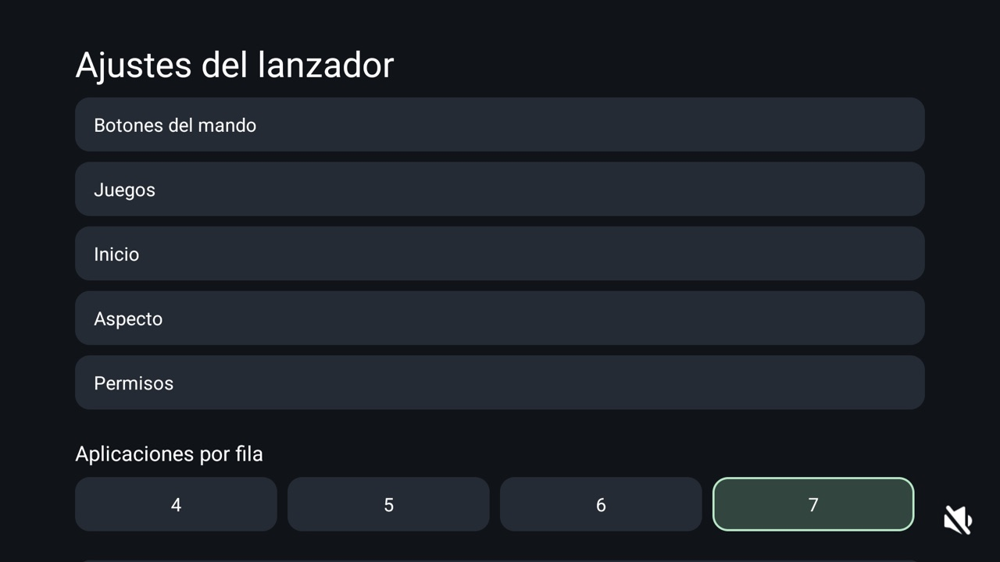
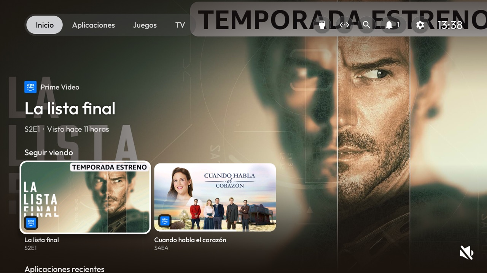
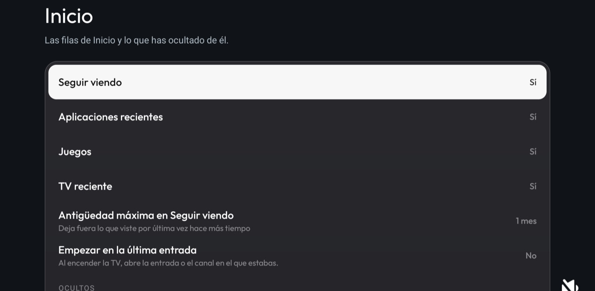
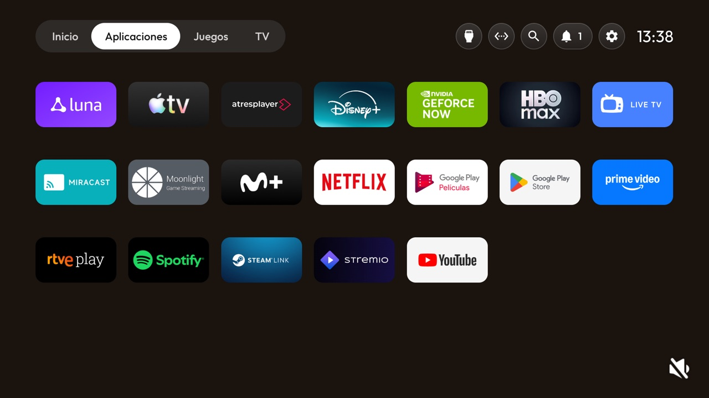
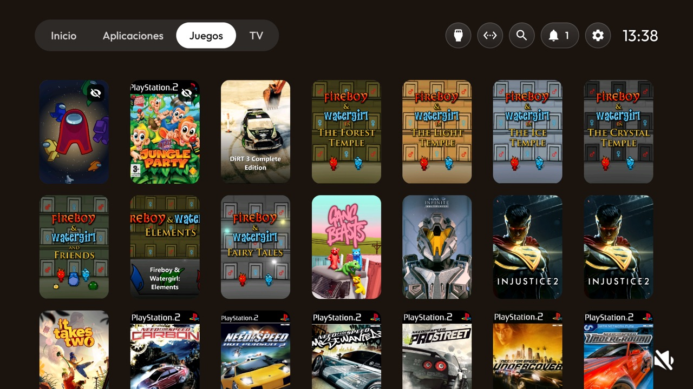
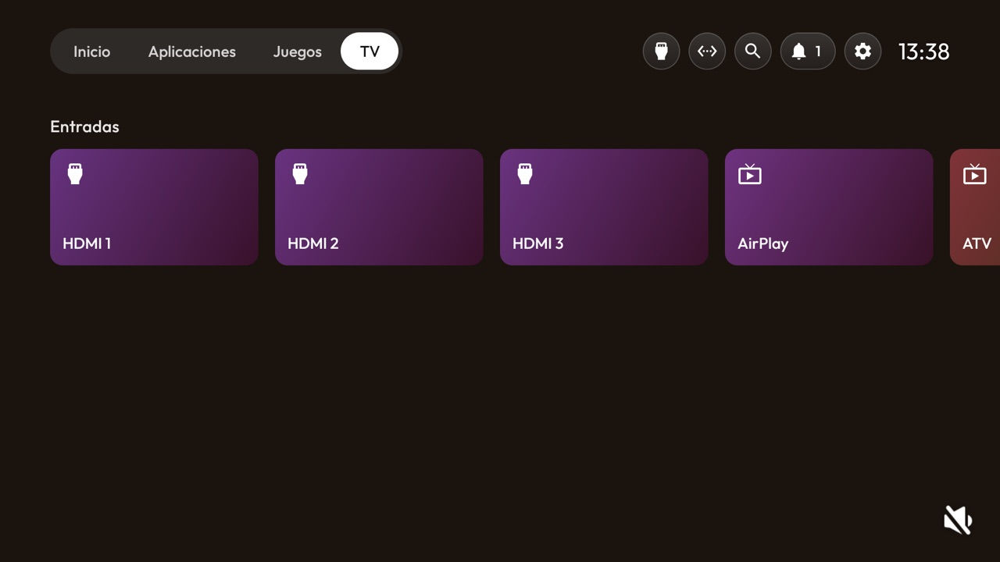

# android-tv
<!-- fork-readme -->

[SferaDev](https://github.com/SferaDev)'s fork of [Gathin23/cleanyourtv](https://github.com/Gathin23/cleanyourtv) with a Google TV style launcher.

## Features

### togglehome key

A remote button switches the stock launcher on and off through the TV's own adb. [Commit](https://github.com/SferaDev/android-tv/commit/89a87c115298549ffa48b9287fb736624725a9a4) <!-- commit: Launcher: togglehome app key switches the stock launcher on and off -->

### On-TV settings

Remote buttons, Home, appearance and permissions set on the TV, with export and import as a JSON file. [Commit](https://github.com/SferaDev/android-tv/commit/e202850a64071cc25e4617d1edb9799f53350698) <!-- commit: Launcher: on-TV settings with backup and import -->

### Google TV style Home

Tabs, search and a notifications bell in the header, a hero whose backdrop follows the focused card, and strips you can hide. [Commit](https://github.com/SferaDev/android-tv/commit/81dca8610af372d1be582e5a06e188417e7dee80) <!-- commit: Launcher: Google TV style home -->

### Continue watching

Shows in progress from other apps' Watch Next rows, with progress and an age limit. [Commit](https://github.com/SferaDev/android-tv/commit/4a47e77258991c88bc39aba73778ea852342eec4) <!-- commit: Launcher: Continue watching from other apps' Watch Next rows -->

### Recent apps

Every app by last use, then a See all card that opens the Apps tab. [Commit](https://github.com/SferaDev/android-tv/commit/8c813ac7c161dfb2a57fd9260822e2c33e711adf) <!-- commit: Launcher: Recent apps strip by last use, then See all -->

### Games from a PC

Finds and pairs with a Sunshine PC, lists its games in a tab and a strip, and starts them in Moonlight. [Commit](https://github.com/SferaDev/android-tv/commit/09f86a0586c7f34d25e1b3702a89be055c65927f) <!-- commit: Launcher: games from a PC over GameStream and Moonlight -->

### Now playing

Cover, title, progress and playback controls in the hero for whatever is playing. [Commit](https://github.com/SferaDev/android-tv/commit/0289652cd9dca28ae5b028565f6ace7cc1ebe769) <!-- commit: Launcher: Now playing card -->

### TV tab and Recent TV

Inputs and channels with now and next in their own tab, a Home strip of what was watched last, and an opt-in start on the last input. [Commit](https://github.com/SferaDev/android-tv/commit/4675296a6a8ffb1fb43f258398ea49e040ebbfce) <!-- commit: Launcher: TV tab, channels and Recent TV -->

### Reliability

Repeated crashes hand Home back to the stock launcher, boots and updates re-apply the takeover, and Home draws at once and starts over on wake. [Commit](https://github.com/SferaDev/android-tv/commit/8ac2a5694afca0c75f212578c34f1aa4e0b2db13) <!-- commit: Launcher: reliability: crash safety net, boot/update check, instant start and a fresh Home on wake -->

**Contributed upstream:** the MiTV-MOEU0 debloat list ([#651](https://github.com/Gathin23/cleanyourtv/pull/651)) and this fork's SHOWCASE row ([#664](https://github.com/Gathin23/cleanyourtv/pull/664)).

**Network:** with Online artwork on, TVmaze and Steam's public store and image CDN for hero backdrops; the GameStream (Sunshine) PC you pair with, on the local network; and the pictures other apps link in their Watch Next rows and now-playing sessions. Nothing else: no analytics, and settings stay on the TV.

---

MIT, like upstream ([LICENSE](LICENSE)); built on CleanYourTV by Gathin and its contributors. Show artwork from [TVmaze](https://www.tvmaze.com/) (CC BY-SA); the Outfit typeface is under the SIL Open Font License.
