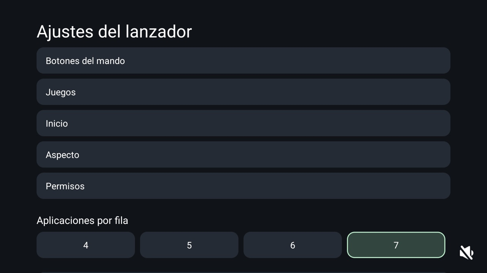
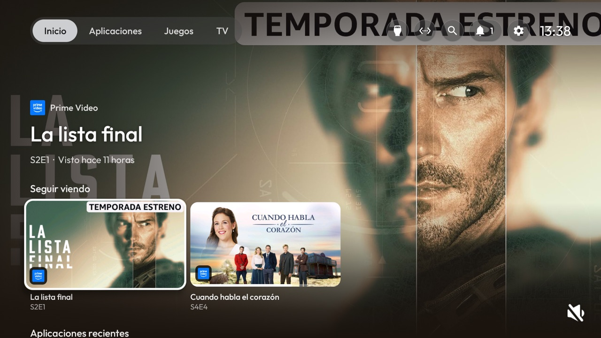
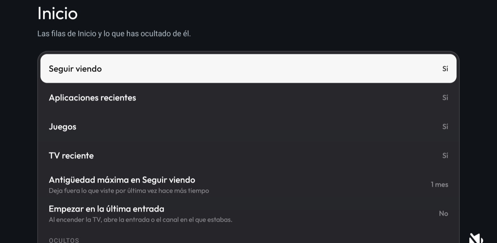
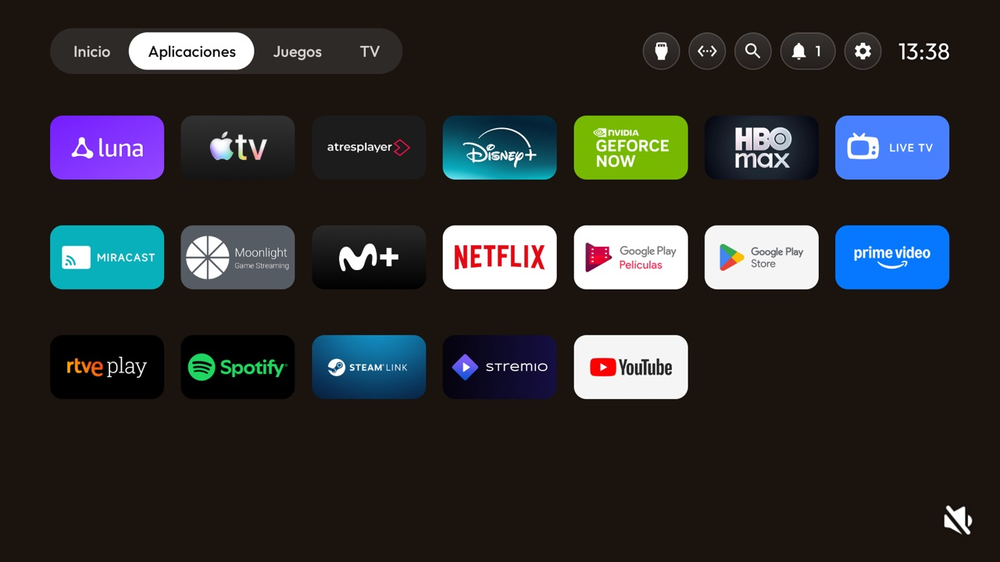
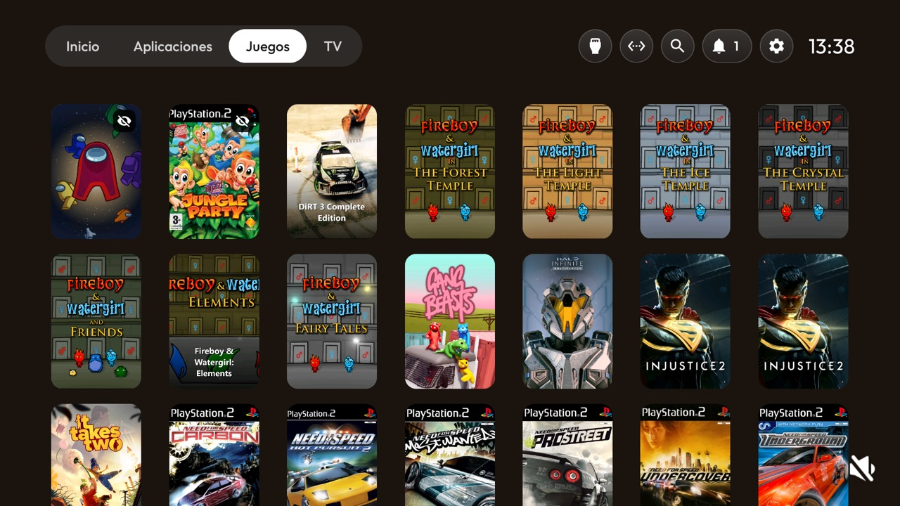
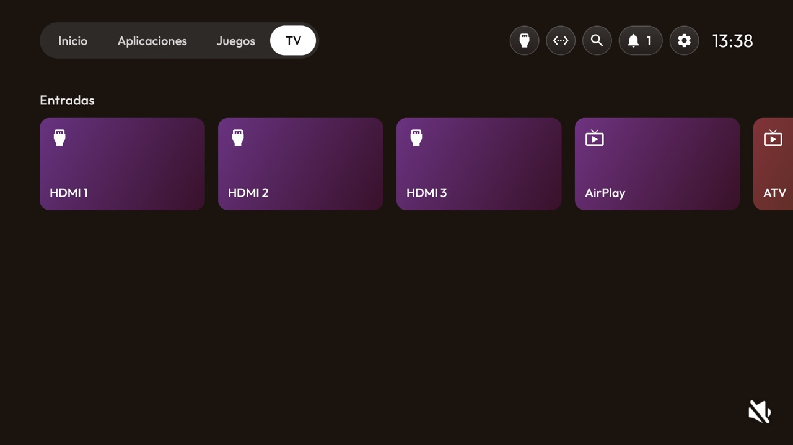

# android-tv
<!-- fork-readme -->

[SferaDev](https://github.com/SferaDev)'s fork of [Gathin23/cleanyourtv](https://github.com/Gathin23/cleanyourtv) with a Google TV style launcher.

## Features

### togglehome key

A remote button switches the stock launcher on and off through the TV's own adb. [Commit](https://github.com/SferaDev/android-tv/commit/05d9b2f5f0bba551608adb60b7de7df5aecf8704) <!-- commit: Launcher: togglehome app key switches the stock launcher on and off -->

### On-TV settings

Remote buttons, Home, appearance and permissions set on the TV, with export and import as a JSON file. [Commit](https://github.com/SferaDev/android-tv/commit/0473b3c1dc3bddedc1560876dbea3ad5a5ff41b7) <!-- commit: Launcher: on-TV settings with backup and import -->

### Google TV style Home

Tabs, search and a notifications bell in the header, a hero whose backdrop follows the focused card, and strips you can hide. [Commit](https://github.com/SferaDev/android-tv/commit/b653b31bc1aced45ab49d5f8192b2b3b4ae0b4da) <!-- commit: Launcher: Google TV style home -->

### Continue watching

Shows in progress from other apps' Watch Next rows, with progress and an age limit. [Commit](https://github.com/SferaDev/android-tv/commit/369a644af3c4c9c4b8d34b39858d0e2392e80a17) <!-- commit: Launcher: Continue watching from other apps' Watch Next rows -->

### Recent apps

Every app by last use, then a See all card that opens the Apps tab. [Commit](https://github.com/SferaDev/android-tv/commit/29bf6ae982d8381d33eacf526a4d15d17946af01) <!-- commit: Launcher: Recent apps strip by last use, then See all -->

### Games from a PC

Finds and pairs with a Sunshine PC, lists its games in a tab and a strip, and starts them in Moonlight. [Commit](https://github.com/SferaDev/android-tv/commit/807763cab0268588317458bed7d0d93206d228a5) <!-- commit: Launcher: games from a PC over GameStream and Moonlight -->

### Now playing

Cover, title, progress and playback controls in the hero for whatever is playing. [Commit](https://github.com/SferaDev/android-tv/commit/767d85a38e426b866fdc8025b3ccad5e8b816ce4) <!-- commit: Launcher: Now playing card -->

### TV tab and Recent TV

Inputs and channels with now and next in their own tab, a Home strip of what was watched last, and an opt-in start on the last input. [Commit](https://github.com/SferaDev/android-tv/commit/fee7fbf94428b3cfb8ef28e1a7a554d46f95fa74) <!-- commit: Launcher: TV tab, channels and Recent TV -->

### Reliability

Repeated crashes hand Home back to the stock launcher, boots and updates re-apply the takeover, and Home draws at once and starts over on wake. [Commit](https://github.com/SferaDev/android-tv/commit/08d70748c447adf515ca0a93ed52b633998c267f) <!-- commit: Launcher: reliability: crash safety net, boot/update check, instant start and a fresh Home on wake -->

### Header shortcuts

Up to four apps pinned to the header as round logo buttons, picked in Settings, Home. [Commit](https://github.com/SferaDev/android-tv/commit/c62707d66e6aa5fed9c54de7b2ffea23e43e0257) <!-- commit: Launcher: header shortcuts for up to four pinned apps -->

### Network warnings

The network button turns orange behind a captive portal and red while offline. [Commit](https://github.com/SferaDev/android-tv/commit/352ded90ab4e51cdb956196c9b9035c26394e0d9) <!-- commit: Launcher: network warnings on the header's network button -->

### Home at power-on

Home instead of Live TV, or always Home, when the TV turns on; it leaves a reboot to Start on last input. [Commit](https://github.com/SferaDev/android-tv/commit/4f519d09b0b36b109bc2ae9eab67c91e37698400) <!-- commit: Launcher: Home at power-on, picked in Settings, Home -->

### Controller passthrough

A switch on the Games page that lets every controller button through, which Moonlight needs for a second controller. [Commit](https://github.com/SferaDev/android-tv/commit/7734ae925b6b199e1bb0d729a5a172c0d3840d24) <!-- commit: Launcher: controller passthrough switch on the Games page -->

**Contributed upstream:** the MiTV-MOEU0 debloat list ([#651](https://github.com/Gathin23/cleanyourtv/pull/651)) and this fork's SHOWCASE row ([#664](https://github.com/Gathin23/cleanyourtv/pull/664)).

**Network:** with Online artwork on, TVmaze and Steam's public store and image CDN for hero backdrops; the GameStream (Sunshine) PC you pair with, on the local network; and the pictures other apps link in their Watch Next rows and now-playing sessions. Nothing else: no analytics, and settings stay on the TV.

---

MIT, like upstream ([LICENSE](LICENSE)); built on CleanYourTV by Gathin and its contributors. Show artwork from [TVmaze](https://www.tvmaze.com/) (CC BY-SA); the Outfit typeface is under the SIL Open Font License.
