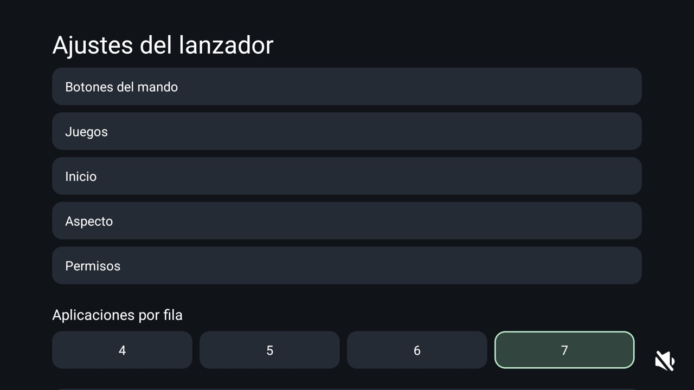
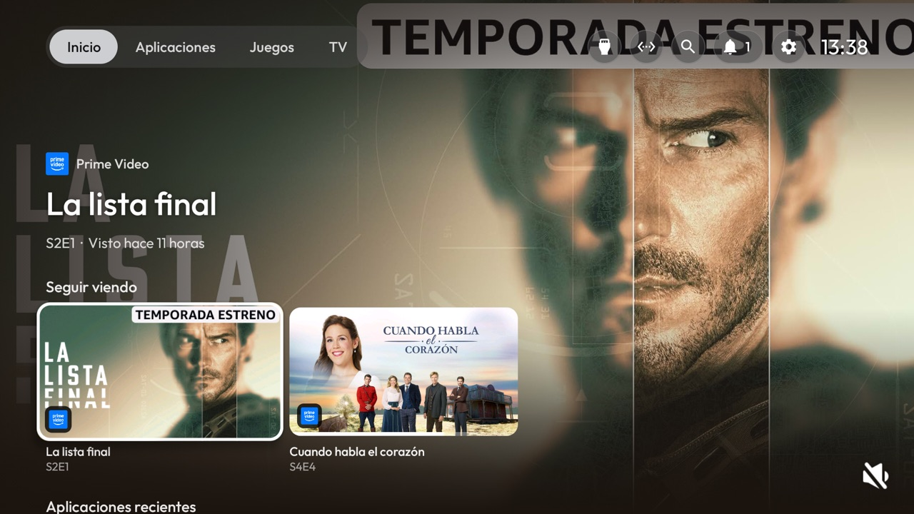
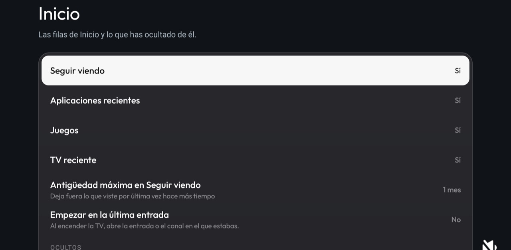
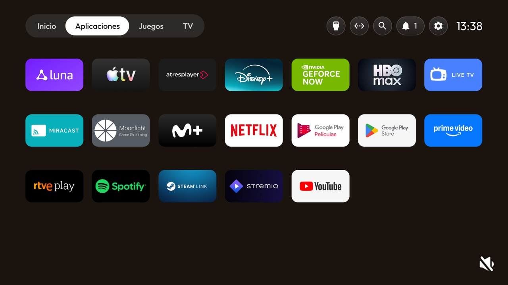
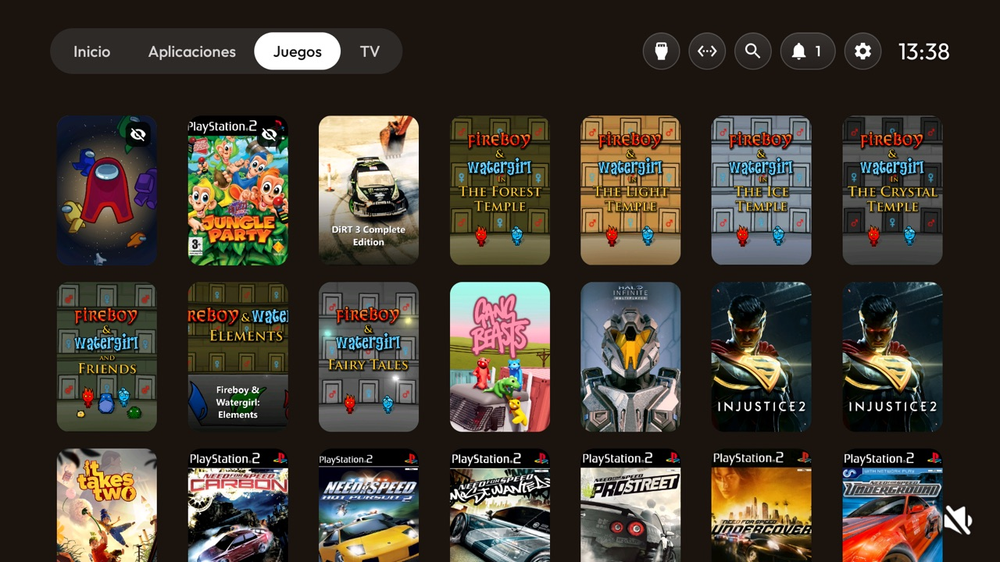
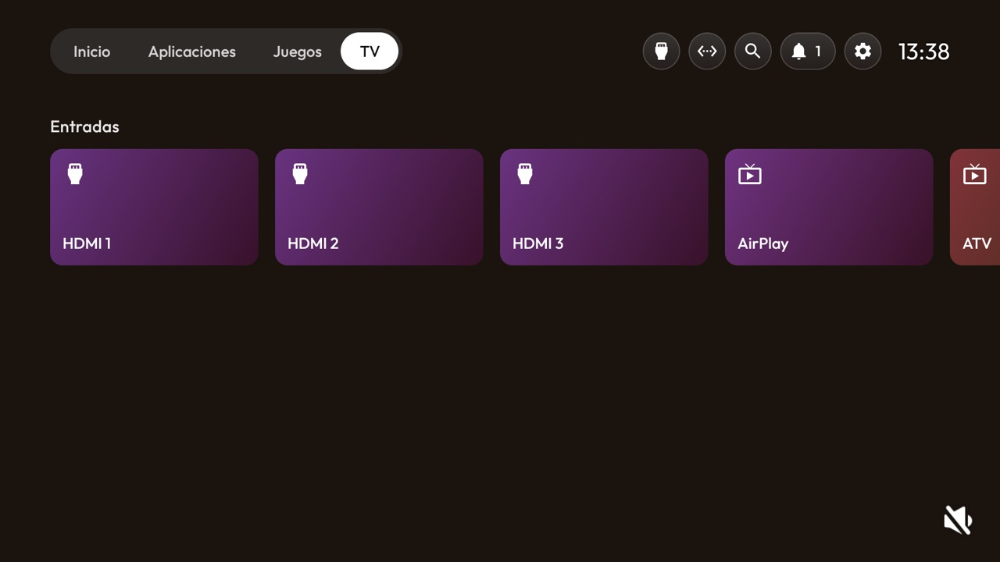

# android-tv
<!-- fork-readme -->

[SferaDev](https://github.com/SferaDev)'s fork of [Gathin23/cleanyourtv](https://github.com/Gathin23/cleanyourtv) with a Google TV style launcher.

## Features

### togglehome key

A remote button switches the stock launcher on and off through the TV's own adb. [Commit](https://github.com/SferaDev/android-tv/commit/9f5db41e16f892cc13ea37ce8e8b5e9a76458dcf) <!-- commit: Launcher: togglehome app key switches the stock launcher on and off -->

### On-TV settings

Remote buttons, Home, appearance and permissions set on the TV, with export and import as a JSON file. [Commit](https://github.com/SferaDev/android-tv/commit/382c9c288b0423eac3430372db2f9167cb960b77) <!-- commit: Launcher: on-TV settings with backup and import -->

### Google TV style Home

Tabs, search and a notifications bell in the header, a hero whose backdrop follows the focused card, and strips you can hide. [Commit](https://github.com/SferaDev/android-tv/commit/a29cfbd71c7ad7b75c375e4625c0204e605fbf94) <!-- commit: Launcher: Google TV style home -->

### Continue watching

Shows in progress from other apps' Watch Next rows, with progress and an age limit. [Commit](https://github.com/SferaDev/android-tv/commit/38862ee1df90e87a1f0871ff6a65ce2bc6d05b6f) <!-- commit: Launcher: Continue watching from other apps' Watch Next rows -->

### Recent apps

Every app by last use, then a See all card that opens the Apps tab. [Commit](https://github.com/SferaDev/android-tv/commit/1e1b962242d0fe35d0d4247e2fe32418ee47c871) <!-- commit: Launcher: Recent apps strip by last use, then See all -->

### Games from a PC

Finds and pairs with a Sunshine PC, lists its games in a tab and a strip, and starts them in Moonlight. [Commit](https://github.com/SferaDev/android-tv/commit/9a28dee20d726b5682f2a510576675c4b4f58ef4) <!-- commit: Launcher: games from a PC over GameStream and Moonlight -->

### Now playing

Cover, title, progress and playback controls in the hero for whatever is playing. [Commit](https://github.com/SferaDev/android-tv/commit/d0eb9b5a5887e4e4d93e04687ffa7086ce2dd91c) <!-- commit: Launcher: Now playing card -->

### TV tab and Recent TV

Inputs and channels with now and next in their own tab, a Home strip of what was watched last, and an opt-in start on the last input. [Commit](https://github.com/SferaDev/android-tv/commit/764065eb5caaa9415742f6d4f5a5f4a96c208c49) <!-- commit: Launcher: TV tab, channels and Recent TV -->

### Reliability

Repeated crashes hand Home back to the stock launcher, boots and updates re-apply the takeover, and Home draws at once and starts over on wake. [Commit](https://github.com/SferaDev/android-tv/commit/de11854e2dab5c255849a05a91e209fa9ac545fa) <!-- commit: Launcher: reliability: crash safety net, boot/update check, instant start and a fresh Home on wake -->

### Header shortcuts

Up to four apps pinned to the header as round logo buttons, picked in Settings, Home. [Commit](https://github.com/SferaDev/android-tv/commit/c53f1bea3d627e505949a5f33904005eb8ca90a1) <!-- commit: Launcher: header shortcuts for up to four pinned apps -->

### Network warnings

The network button turns orange behind a captive portal and red while offline. [Commit](https://github.com/SferaDev/android-tv/commit/c8307fc3a47b86fddf7e1d12fd7ae0a255e35ca1) <!-- commit: Launcher: network warnings on the header's network button -->

### Home at power-on

Home instead of Live TV, or always Home, when the TV turns on; it leaves a reboot to Start on last input. [Commit](https://github.com/SferaDev/android-tv/commit/2232fbf6e889ed2ff18fb9701941edc66f557469) <!-- commit: Launcher: Home at power-on, picked in Settings, Home -->

### Controller passthrough

A switch on the Games page that lets every controller button through, which Moonlight needs for a second controller. [Commit](https://github.com/SferaDev/android-tv/commit/10bb21b7b5296011d3cfd6be858f1243529a73dd) <!-- commit: Launcher: controller passthrough switch on the Games page -->

**Contributed upstream:** the MiTV-MOEU0 debloat list ([#651](https://github.com/Gathin23/cleanyourtv/pull/651)) and this fork's SHOWCASE row ([#664](https://github.com/Gathin23/cleanyourtv/pull/664)).

**Network:** with Online artwork on, TVmaze and Steam's public store and image CDN for hero backdrops; the GameStream (Sunshine) PC you pair with, on the local network; and the pictures other apps link in their Watch Next rows and now-playing sessions. Nothing else: no analytics, and settings stay on the TV.

---

MIT, like upstream ([LICENSE](LICENSE)); built on CleanYourTV by Gathin and its contributors. Show artwork from [TVmaze](https://www.tvmaze.com/) (CC BY-SA); the Outfit typeface is under the SIL Open Font License.
